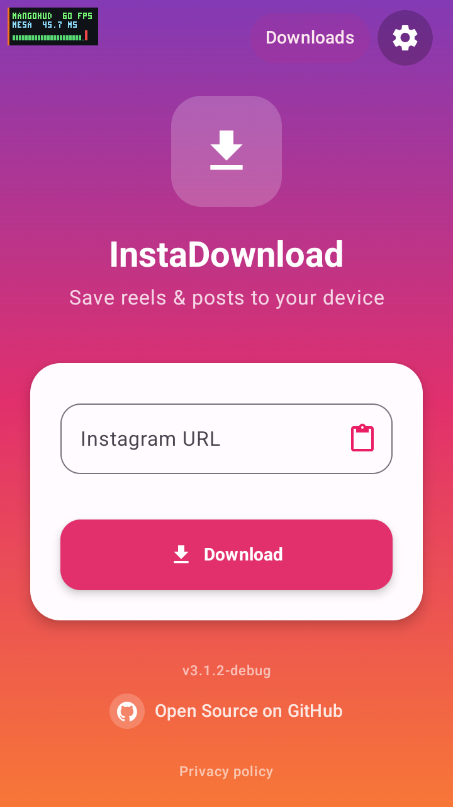

# InstaDownload

A privacy-friendly Android app for downloading public Instagram reels, photos, videos, and carousel posts.

**No login, no ads, no tracking for public content. Fully open source.**

> **This repository** (`ampl0/InstaDownload-Plus`) is a maintained fork of
> [Orang-Studio/InstaDownload](https://github.com/Orang-Studio/InstaDownload) that adds an
> easy-save share flow, in-app download progress, a retry list for failed links, success/fail
> sounds, curated history links and gallery fixes. See
> [`docs/FEATURES.md`](docs/FEATURES.md) for the full changelog and
> [`docs/IDEA_AND_PROCESS.md`](docs/IDEA_AND_PROCESS.md) for how it was built.

<p align="center">
  <a href="../../releases/latest">
    
  </a>
  <a href="../../releases">
    
  </a>
  <a href="LICENSE">
    
  </a>
  
  
  
</p>

## Download

Grab the ready-to-install debug APK from the
[**latest release**](../../releases/latest):

- `InstaDownload-3.1.2-debug.apk` — signed debug build, installs alongside the store version
  (package `com.vakarux.instadownload.debug`).

> The debug build is installable right away for testing. For a signed production build use the
> [Upstream store listings](#other-distribution) or build the `release` variant yourself (see
> [Building](#building-from-source)).

## Features

- Download Instagram photos, reels, and videos.
- Download every photo or video from carousel posts.
- Bulk download from accounts.
- Paste a link and save the media directly to your device.
- **Easy save mode** — share a link to the app and it downloads in the background with a progress
  notification, no extra taps (on by default, toggle in Settings).
- **Background downloads with progress** — a foreground service keeps going while you leave the app.
- **Failed download retry list** — links that fail are saved (tracking stripped) so you can retry
  one or all of them later. Links are **never removed automatically** — not even after a successful
  retry — until you remove them or tap **Clear failed**.
- **Download sounds** — a distinct tone on success and on failure (on by default, toggle in Settings).
- **Persistent link history** — every link you paste or share is remembered, including ones that
  failed, so nothing is lost. Only an explicit **Remove** or **Clear history** deletes an entry.
- **Multi-select copy / share / export** — long-press any link in the Downloads, Failed or Links tab
  to select several, then copy them, share them as text, or export them to a `.txt` file.
- **Clean history links** — share/copy/open history entries use `?`-stripped links, so no sharer
  tracking parameters leak.
- **Keep screen on** while a download is running.
- **Quality selection** — Auto / Data saver / Best / Custom width.
- Downloads show up in the gallery and in the in-app library.
- **No ads**, analytics, or tracking.
- No third-party download service.
- **No Instagram login** required for public content.
- Fully open source under the GPLv3 License.
- Works on Android 17!

> [!IMPORTANT]
> The upstream **Stories version** requires an Instagram login (optional for reels). This fork
> tracks `main` (the standard, no-login version).

## Screenshots

<p align="center">
  
  
  
</p>

<p align="center">
  <sub>Left/centre: upstream themes. Right: <strong>this fork running</strong> — note the
  <strong>Downloads</strong> library button and the <strong>Settings</strong> gear in the top bar.</sub>
</p>

## Speed comparison

<p align="center">
  <br>
  <sub>InstaDownload: 6.70s &nbsp;·&nbsp; InSaver: 35.27s</sub>
</p>

## Usage

**Method 1 — Share from Instagram (easy save):**

1. Press **Share** in Instagram.
2. Pick **InstaDownload**.
3. With easy save on, the download starts in the background immediately — watch the progress in the
   notification. With easy save off, the app opens with the link pre-filled.

**Method 2 — Paste a link:**

1. Copy the URL of an Instagram post, reel, or video.
2. Open **InstaDownload**.
3. Paste the URL.
4. Tap **Download**.
5. Find the media in your device's `Downloads` folder, in the gallery, or in the in-app library.

**Retrying a failed download:**

1. Open the download library and pick the **Failed (N)** tab.
2. Tap **Retry** on one link, or **Retry all**. Retrying does **not** remove the entry — the link
   stays until you remove it or tap **Clear failed**.

**Reusing your links:**

1. Open the library and pick the **Links** tab (a full history of every link you pasted or shared,
   including failed ones).
2. Long-press a link to start selection, then tap more links to add them.
3. Use the toolbar to **copy**, **share** them as text, or **export** them to a `.txt` file.
4. Per link you can **Download** it again or **Remove** it; **Clear history** (with a confirmation)
   empties the whole list.

<details>
<summary><strong>Supported Instagram links</strong></summary>

<br>

InstaDownload supports public links containing:

- `instagram.com/p/`
- `instagram.com/reel/`
- `instagram.com/tv/` (`tv` is a deprecated link type)

The upstream Stories version additionally supports Instagram Stories and private posts your account
has permission to view.

</details>

<details>
<summary><strong>App permissions</strong></summary>

<br>

InstaDownload may request the following Android permissions:

- **Internet** — retrieve media from Instagram
- **Network state** — detect data saver mode to pick a lower quality
- **Storage** — save files on older Android versions
- **Notifications** — show download progress and completion alerts, and run the foreground service
- **Vibration** — optional haptic feedback

The standard version does not require an Instagram account or login.

</details>

## Building from source

Prerequisites:

- **JDK 17+** (the CI uses 17; JDK 21 also works)
- **Android SDK** with `platforms;android-37.0` and `build-tools` installed
- The Gradle wrapper is bundled, so no separate Gradle install is needed

```bash
git clone https://github.com/ampl0/InstaDownload-Plus.git
cd InstaDownload

# Point Gradle at your SDK (or set ANDROID_HOME / sdk.dir in local.properties)
export ANDROID_HOME=/path/to/android-sdk
export JAVA_HOME=/path/to/jdk

cd InstaDownload
./gradlew :app:assembleDebug      # debug APK (installs alongside the store app)
./gradlew :app:assembleRelease    # release APK/AAB (needs a signing config)
```

The debug APK lands at
`InstaDownload/app/build/outputs/apk/debug/instadownload-debug.apk`.

The project layout:

```
InstaDownload/                     # repo root
├── README.md                      # this file
├── docs/                          # project documentation
│   ├── FEATURES.md
│   ├── IDEA_AND_PROCESS.md
│   ├── AGENT_REPRODUCTION_GUIDE.md
│   └── ARCHITECTURE.md
├── img/                           # screenshots and badges
└── InstaDownload/                 # the Gradle project
    ├── app/
    │   └── src/main/java/com/vakarux/instadownload/
    │       ├── MainActivity.kt          # main UI + paste save flow
    │       ├── QuickDownloadActivity.kt # share entry point
    │       ├── QuickDownloadService.kt  # background foreground-service downloads
    │       ├── DownloadsDialog.kt       # library + links + failed tabs, multi-select copy/share/export
    │       ├── InstagramDownloader.kt   # Instagram API/reverse-engineering layer
    │       ├── DownloadStorage.kt       # file writing + MediaScanner
    │       ├── DownloadHistory.kt       # saved history
    │       ├── FailedDownloads.kt       # failed-link persistence (never auto-removed)
    │       ├── LinkHistory.kt           # persistent paste/share link history
    │       ├── DownloadSounds.kt        # success/failure tones
    │       ├── AppSettings.kt           # preferences
    │       └── ProfileBrowser.kt        # profile bulk download UI
    ├── app/build.gradle.kts
    └── gradle/
```

## Documentation

| Document | What it covers |
| --- | --- |
| [`docs/FEATURES.md`](docs/FEATURES.md) | Feature list and the changes added in this fork |
| [`docs/IDEA_AND_PROCESS.md`](docs/IDEA_AND_PROCESS.md) | The idea, motivation and the process that produced this code |
| [`docs/AGENT_REPRODUCTION_GUIDE.md`](docs/AGENT_REPRODUCTION_GUIDE.md) | A step-by-step guide for an AI agent (or human) to reproduce these changes |
| [`docs/ARCHITECTURE.md`](docs/ARCHITECTURE.md) | How the app is put together and where each feature lives |

## Privacy

InstaDownload does not include advertisements, analytics, user tracking, paid features or a
third-party download server. Media processing and file saving happen directly on your device. See
[`PRIVACY.md`](PRIVACY.md).

## Disclaimer

> [!CAUTION]
> Only download media that you own or have permission to save. Respect copyright, content creators'
> privacy, and Instagram's [Terms of Service](https://help.instagram.com/581066165581870).

This project is provided for educational and personal use. InstaDownload is not affiliated with,
endorsed by, or associated with Instagram or Meta.

## Contributing

Contributions are welcome — see [`CONTRIBUTING.md`](CONTRIBUTING.md). For bugs or feature requests,
use [GitHub Issues](../../issues).

## Other distribution

The upstream project is also available on Google Play and F-Droid:

<p align="center">
  <a href="https://play.google.com/store/apps/details?id=com.vakarux.instadownload">
    
  </a>
  &nbsp;
  <a href="https://f-droid.org/packages/com.vakarux.instadownload">
    
  </a>
</p>

## Keywords

`instagram downloader` · `instagram reels downloader` · `instagram video download` · `instagram
photo download` · `instagram carousel download` · `bulk instagram download` · `android` · `kotlin`
· `jetpack compose` · `material design` · `open source` · `GPLv3` · `no ads` · `no login` · `no
tracking` · `privacy friendly` · `fdroid` · `background downloads` · `share to download` · `fail
retry` · `reverse engineering`

## License

InstaDownload is available under the [GPLv3 License](LICENSE).

- Platform: Android; iOS (upstream)
- Official source stores (upstream): GitHub, F-Droid, Google Play
- Made by humans and AI for API reverse engineering 🧡
